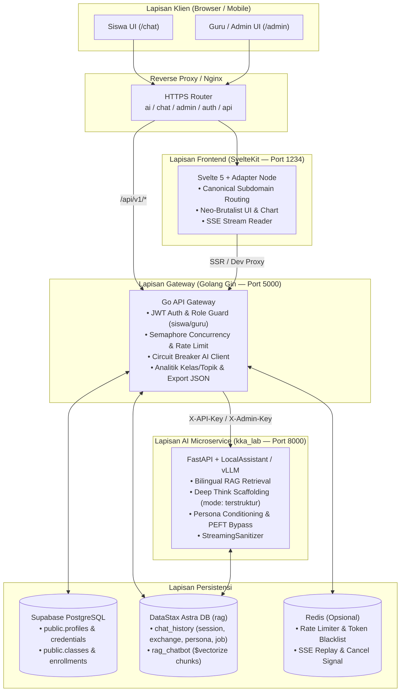
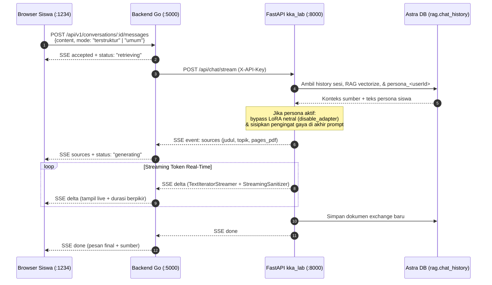
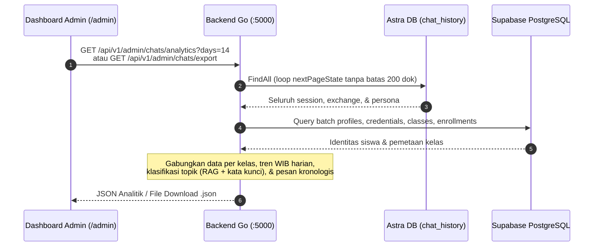

# Arsitektur Sistem — TAKO AI (`chatbot_kka`)

Dokumen ini menjelaskan rancangan arsitektur perangkat lunak, batas keamanan, pemisahan penyimpanan data, serta alur komunikasi hulu ke hilir pada platform **TAKO AI** untuk pembelajaran Koding dan Kecerdasan Artifisial (KKA).

---

## 1. Gambaran Umum 3-Tier (Decoupled Architecture)

Aplikasi menerapkan arsitektur **3 lapis terpisah** agar browser pengguna tidak pernah mengakses layanan AI GPU maupun basis data secara langsung:

1. **Lapisan Presentasi — Frontend (`fe/`, Port `1234`)**: Aplikasi Svelte 5 + SvelteKit (`@sveltejs/adapter-node`) yang menangani UI/UX siswa & guru, manajemen state reaktif berbasis Runes, rendering Markdown/KaTeX, dan konsumsi *Server-Sent Events (SSE)*.
2. **Lapisan Gateway & Logika Sekolah — Backend Go (`be/`, Port `5000`)**: API Gateway berbasis Gin yang menegakkan autentikasi JWT, otorisasi peran (`siswa` vs `guru`), *rate limiting*, manajemen akun siswa/kelas, analitik penggunaan, export JSON, serta proksi streaming ke layanan AI.
3. **Lapisan Inferensi & RAG — Python AI Service (`kka_lab`, Port `8000`)**: Microservice FastAPI yang mengelola *Vector Retrieval (RAG)* di Astra DB, penyusunan prompt pedagogis, sanitasi output, adaptasi persona siswa, serta inferensi LLM `Qwen/Qwen3-4B-Instruct-2507` (+ LoRA PEFT).

---

## 2. Pemisahan Tanggung Jawab Penyimpanan Data (Dual-Store)

Sesuai [001_init.sql](./be/migrations/001_init.sql), data aplikasi dipisahkan secara tegas berdasarkan sifat transaksional dan skalabilitasnya:

| Penyimpanan | Entitas yang Disimpan | Alasan Arsitektural |
| :--- | :--- | :--- |
| **Supabase PostgreSQL** | `profiles`, `credentials`, `classes`, `enrollments` | Relasional ketat untuk identitas sekolah, kredensial bcrypt, pemetaan NIS, dan daftar kelas (termasuk paginasi SQL `LIMIT/OFFSET` dan agregasi keaktifan kelas). |
| **DataStax Astra DB** (`rag.chat_history`) | Dokumen `type: "session"`, `"exchange"`, `"persona"`, `"ingestion_job"`, `"auto_learned"`, `"knowledge"` | Terpusat dan berbagi akses langsung dengan layanan AI `kka_lab` menggunakan Data API + cursor `nextPageState`. |
| **DataStax Astra DB** (`rag.rag_chatbot`) | Potongan teks modul KKA beserta embedding otomatis `$vectorize` | Mendukung *scoped vector search* untuk materi global kurikulum maupun dokumen unggahan pribadi siswa. |
| **Redis (Opsional)** | Rate limit per user, blacklist JWT logout, buffer event SSE sementara, channel pembatalan generasi | Jika Redis tidak aktif, backend Go tetap berjalan dengan degradasi aman tanpa mematikan fungsi utama. |

---

## 3. Arsitektur Backend Go (`be/`)

Backend Go disusun berdasarkan batas fitur di bawah `be/internal/`:

- **`internal/core/`**:
  - `config`: Pemuatan dan validasi variabel `.env` (`PORT=5000`, `CHAT_AI_TIMEOUT=240s`, batas unggah, rahasia internal).
  - `aiclient`: HTTP & SSE client ke `kka_lab` dengan *Circuit Breaker*, injeksi header rahasia `X-API-Key` / `X-Admin-Key`, serta `ResponseHeaderTimeout` terpisah dari `IdleConnTimeout` untuk generasi lokal GPU.
  - `astradb`: Klien Astra DB Data API dengan retry backoff, `Find` berpaginasi, dan `FindAll` berbasis loop `nextPageState` hingga tuntas.
  - `middleware`: `RequireAuth` (JWT + cek Redis blacklist), `RequireRole("guru")`, `CORS` (mengekspos `Content-Disposition` untuk unduhan JSON), `RateLimitPerUser`, dan `BodyLimit`.
- **`internal/features/`**:
  - `auth`: Login siswa/guru, profil aktif `/auth/me`, dan logout.
  - `chat` & `conversations`: Pengelolaan room percakapan di Astra DB, orkestrasi turn SSE dengan *keepalive* berkala, manajemen admin (`/admin/chats`), endpoint analitik `/admin/chats/analytics`, dan ekspor penuh `/admin/chats/export`.
  - `students`: CRUD akun siswa + paginasi & filter kelas di Supabase (`/admin/students`).
  - `persona`: Pengambilan, validasi keamanan lewat `kka_lab`, dan sinkronisasi field `persona` ke Astra DB dengan prioritas instruksi siswa agar tidak bertabrakan dengan nada bawaan.
  - `rag` & `memory`: Penerus unggahan materi PDF/dokumen (tanpa buffering penuh di memori), pemantauan status job OCR, dan audit auto-learned.

---

## 4. Arsitektur Frontend Svelte 5 (`fe/`)

Frontend dibangun dengan pendekatan **Feature-Sliced Modular** di `fe/src/lib/features/` (dipisahkan ke lapisan `domain/`, `application/`, `infrastructure/`, dan `presentation/`):

- **Routing Multi-Subdomain & Lokal** (`src/lib/shared/config/subdomains.ts`):
  - Mendukung mode subdomain produksi (`ai.*`, `chat.*`, `admin.*`, `auth.*`) sekaligus mode path tunggal di pengembangan lokal (`http://127.0.0.1:1234/home`, `/chat`, `/admin`, `/login`).
  - Penjaga peran (`resolveSafePostLoginTarget`) memastikan akun `guru` otomatis diarahkan ke `/admin` dan akun `siswa` tidak dapat membuka rute admin.
- **State Management Berbasis Svelte 5 Runes (`*.svelte.ts`)**:
  - `RoomStateController` (`chat`): Mengelola streaming SSE delta per token, status berpikir + timer live, lampiran dokumen, tombol **Deep Think**, dan penarikan riwayat pesan dengan guard anti-*race condition*.
  - `PersonalizationController` (`settings`): Memakai `$derived` `isDirty` untuk memicu penyimpanan ke backend hanya ketika pengguna menekan tombol **Simpan Persona**.
  - `AdminAnalyticsController`, `AdminChatsController`, `AdminStudentsController` (`admin`): Mengatur filter rentang hari, grafik perbandingan kelas & topik, paginasi tabel siswa, serta unduhan Blob JSON untuk export riwayat.
- **Sistem UI & Desain**:
  - Token warna Light/Dark di `tokens.css` & `theme.css`, gaya komponen **Neo-Brutalism** (`neobrutalism.css`), aturan global kursor pointer Tailwind v4 di `base.css`, serta sanitasi Markdown + DOMPurify (`markdown.css`).

---

## 5. Alur Data Utama

### Alur A: Percakapan Real-Time Streaming, Deep Think & Persona

### Alur B: Analitik Dashboard Admin & Export JSON Penuh

---

## 6. Topologi Deployment VPS (Port & Reverse Proxy)

Di lingkungan produksi VPS, layanan diisolasi pada `127.0.0.1` dengan alokasi port tetap berikut:

- **Frontend (`fe/`, Node Adapter)**: `127.0.0.1:1234` (`npm run build && npm start`)
- **Backend API (`be/`, Binary Go)**: `127.0.0.1:5000` (`./kka-api` atau `go run ./cmd/api`)
- **AI Microservice (`kka_lab`, Uvicorn)**: `127.0.0.1:8000` (atau diakses aman melalui Cloudflare Tunnel)

Reverse proxy publik (Nginx / Caddy / Cloudflare) meneruskan traffic domain web ke `127.0.0.1:1234` dan rute API `/api/v1/*` ke `127.0.0.1:5000` dengan `proxy_buffering off` agar streaming SSE berjalan tanpa jeda.
